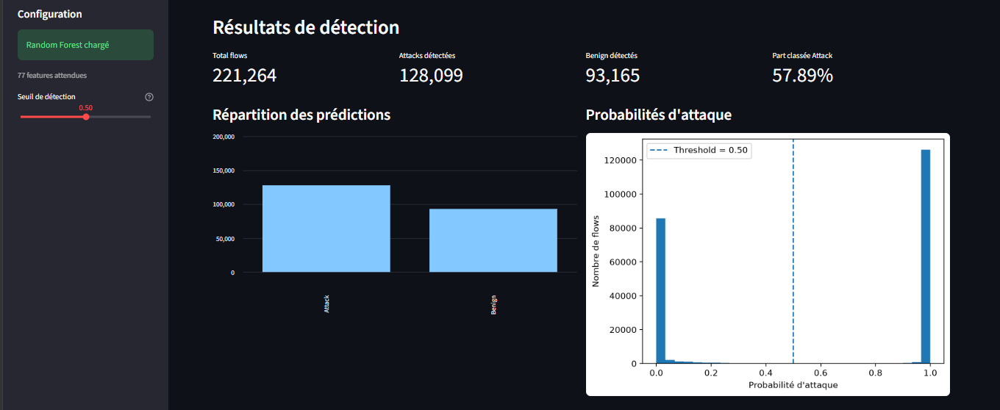
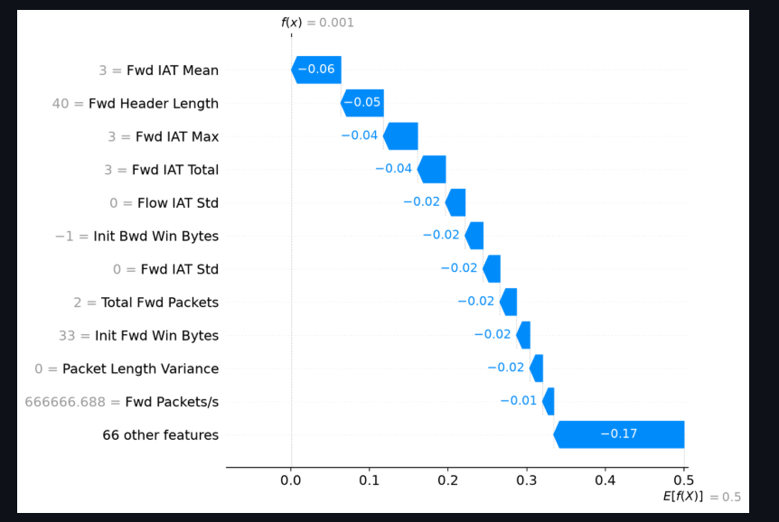

# AI-IDS — Explainable Network Intrusion Detection System

An explainable machine-learning prototype for network intrusion detection.

## Overview

AI-IDS uses a Random Forest classifier to analyse network-flow features and
identify potentially malicious traffic. Its Streamlit dashboard provides
predictions, probability scores, downloadable results and SHAP explanations.

## Main Features

- Network-flow analysis from CSV and Parquet files
- Input validation and numerical preprocessing
- Benign vs Attack predictions
- Configurable prediction threshold
- Detection statistics and probability distribution
- Downloadable prediction results in CSV format
- Global SHAP feature importance
- Local SHAP waterfall explanations for individual flows
- Optional evaluation when ground-truth labels are provided

## Technology Stack

- Python
- pandas and NumPy
- scikit-learn
- Random Forest
- SHAP
- Streamlit
- Matplotlib
- Joblib

## Project Structure

```text
ai-ids/
├── app.py
├── requirements.txt
├── .gitignore
├── models/
├── src/
├── scripts/
├── data/
│   ├── raw/
│   └── processed/
└── reports/
```

## Installation

Python 3.11 is recommended.

Create and activate a virtual environment:

```powershell
python -m venv .venv
.\.venv\Scripts\Activate.ps1
```

Install dependencies:

```powershell
python -m pip install -r requirements.txt
```

## Run the Dashboard

From the project root:

```powershell
python -m streamlit run app.py
```

Upload a CSV or Parquet file containing the features expected by the
saved model. The application validates the required columns before prediction.

## SHAP Explainability

The dashboard provides:

- Global feature importance based on mean absolute SHAP values
- Local waterfall explanations for a selected flow

SHAP explanations describe how features contribute to model output.
They do not establish causality or guarantee that a detected flow is malicious.

## Model and Data

The dashboard expects the model bundle at:

`models/random_forest_ids.joblib`

The model must be available locally when running the application.
Datasets are excluded from version control by default.

Use only datasets you are authorised to analyse. Check the dataset licence
and remove sensitive information before publishing files or reports.

## Limitations

- Predictions depend on the quality and distribution of the training data.
- Performance may change on traffic from different environments.
- Results should be validated before any operational security use.
- The application is a research prototype, not a replacement for a
  production security monitoring system.

## Future Improvements

- Automated testing and continuous integration
- Improved dataset and label validation
- More detailed evaluation reports
- Deployment documentation and reproducible experiments

## License

No license has been specified yet. Add an appropriate license before
allowing others to reuse or redistribute this project.


---

## Dashboard Preview

The dashboard displays network traffic analysis, attack predictions, detection probabilities, and evaluation metrics.



## Explainable AI with SHAP

SHAP provides global feature importance and local explanations to help understand why the model classifies a network flow as an attack.




## Model Evaluation & Generalization

The model was evaluated on a general evaluation set and on held-out
network traffic files to assess its ability to generalize to unseen data.

### General Evaluation

| Metric | Score |
|---|---:|
| Accuracy | 99.27% |
| Attack F1-score | 98.91% |
| ROC-AUC | 99.96% |

Evaluation set: 12,115 samples.

### Held-Out Dataset Evaluation

| Test dataset | Accuracy | Attack Recall | Attack F1-score | ROC-AUC |
|---|---:|---:|---:|---:|
| DDoS-Friday | 81.22% | 62.66% | 77.00% | 89.98% |
| DoS-Wednesday | 51.53% | 3.12% | Not reported | 97.19% |

The held-out tests reveal a generalization gap, particularly for
DoS-Wednesday. These results highlight the importance of evaluating
intrusion detection models on unseen traffic and investigating
decision thresholds, feature distributions, and missed attacks.

### Explainability

SHAP is used to investigate global feature importance and individual
predictions, helping analyze which features influence the model's
decisions and where attacks may be missed.
